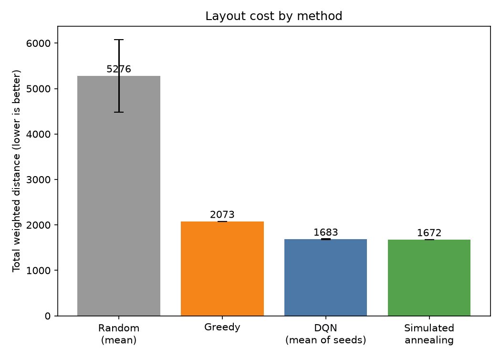
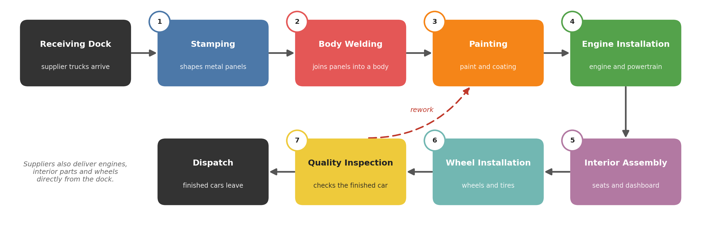
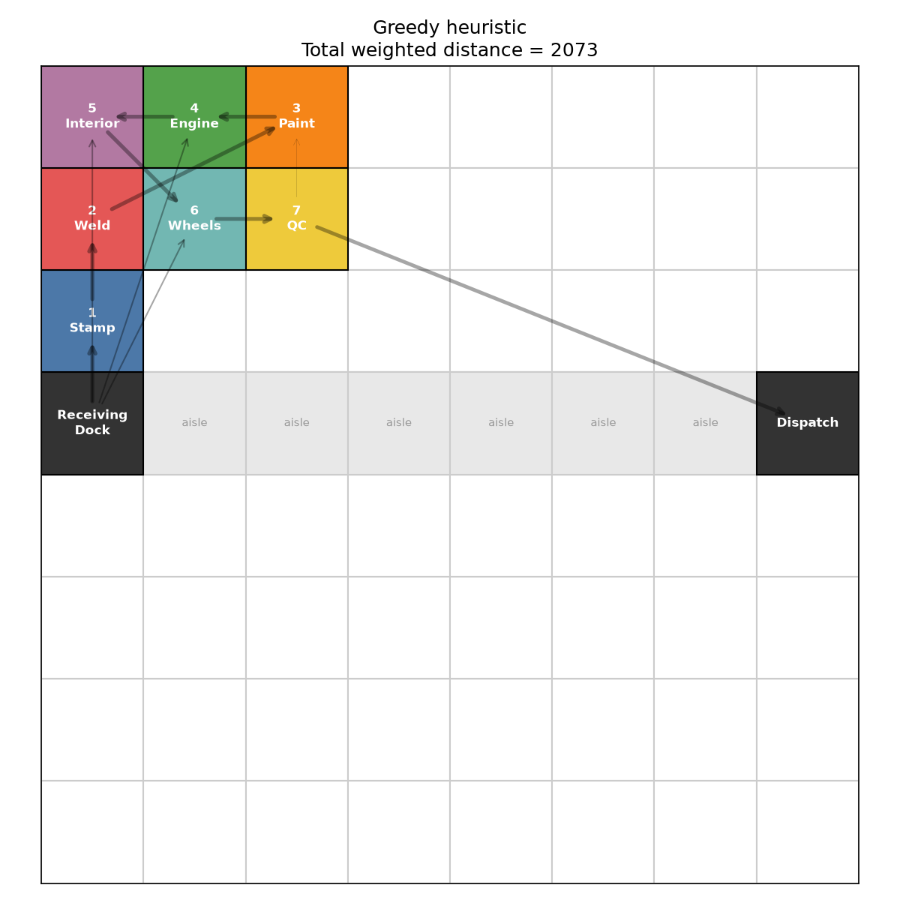
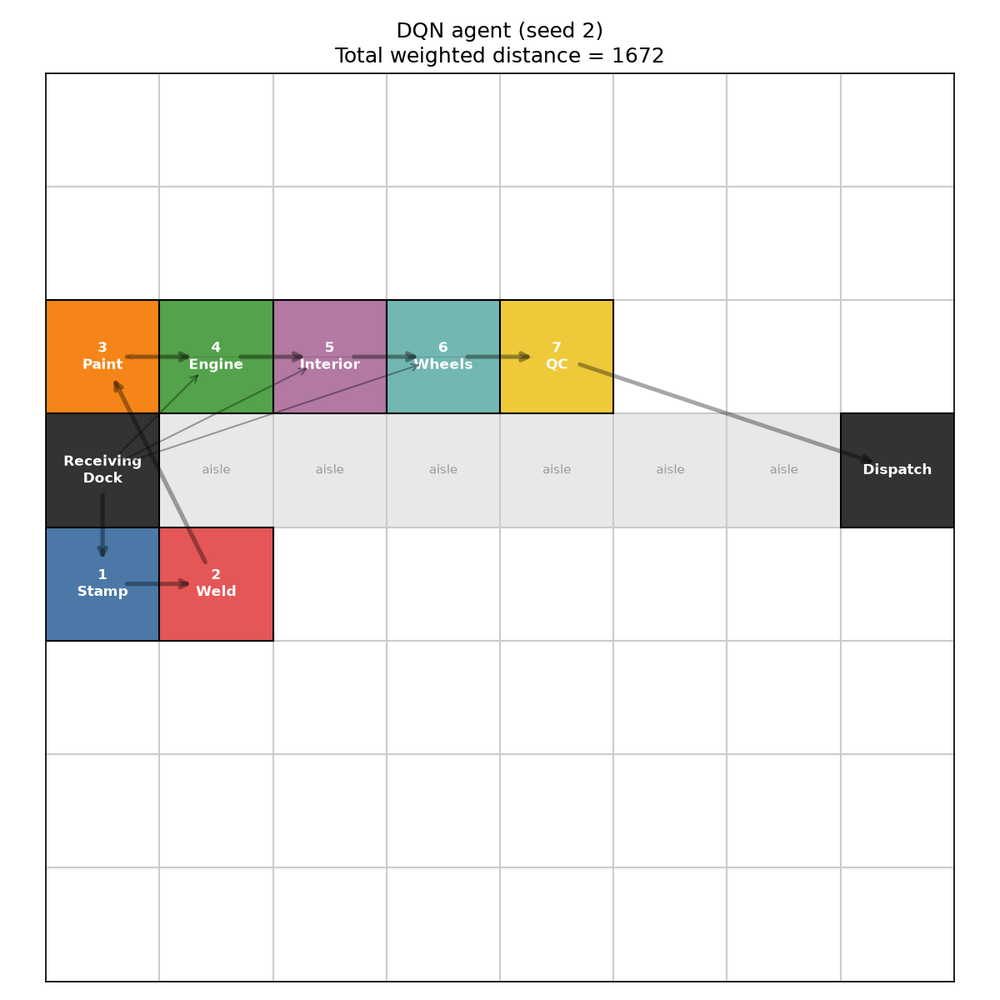
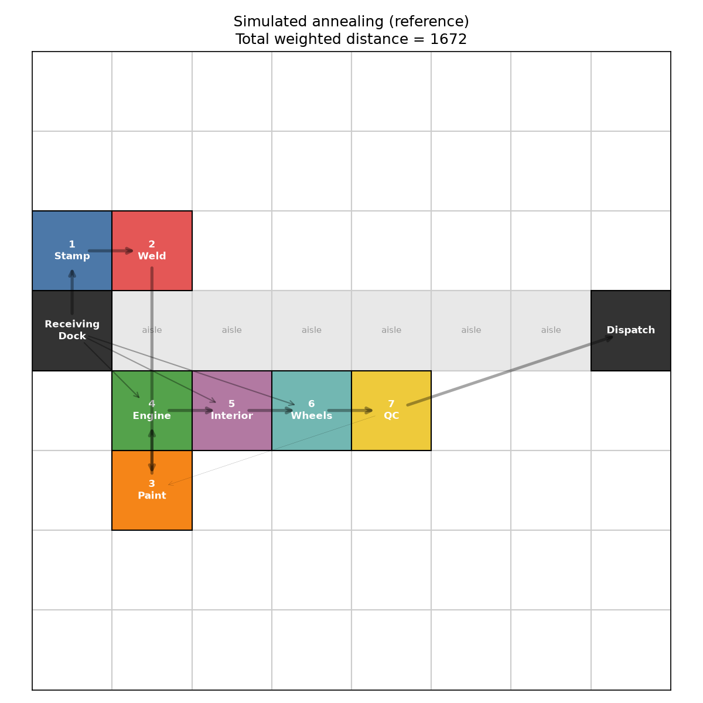
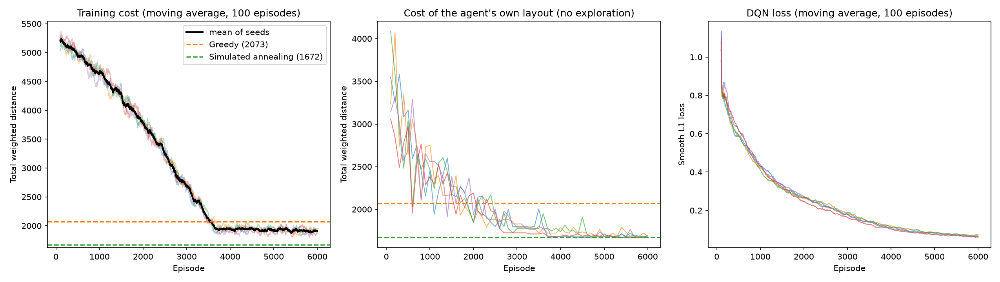

<div align="center">

# SmartFactory-RL

### Teaching a computer to design a car factory floor

An agent learns where to place each workstation so that parts and vehicles
travel the shortest possible distance.


[Result](#the-result) &nbsp;·&nbsp; [The factory](#the-factory) &nbsp;·&nbsp; [How it learns](#how-it-learns) &nbsp;·&nbsp; [Run it](#run-it) &nbsp;·&nbsp; [Limitations](#limitations)

<br>



</div>

<br>

## The result

The agent's layouts cut transport effort by **68%** compared with random placement,
and by **19%** compared with a simple rule of thumb. They land within about **1%**
of a strong reference method, simulated annealing.

| Method | Transport effort (lower is better) | Better than random by |
|:--|--:|--:|
| Random placement | 5276 | n/a |
| Rule of thumb (greedy) | 2073 | 61% |
| **Learning agent (average of 5 runs)** | **1683** | **68%** |
| Simulated annealing (reference) | 1672 | 68% |

Two of the five runs reached 1672, the same score as the reference. All five final
layouts followed every rule, which was checked separately.

<br>

## The factory

A car assembly plant has seven stations to place on an 8 x 8 floor grid. The
receiving dock (where supplier trucks arrive) and the dispatch area (where finished
cars leave) are fixed at opposite ends, joined by a main aisle.

<div align="center">

</div>

The agent's job is to decide where on the floor each numbered station goes.

**How a layout is scored.** Moving 100 loads across 3 cells costs 100 x 3 = 300.
Add this up for every pair of stations. A lower total means a better layout.

**Rules every layout must follow**

- One station per cell.
- Nothing may be placed on the aisle or on the fixed dock and dispatch cells.
- Painting must stay at least 3 cells away from Body Welding, because sparks and
  dust ruin fresh paint.

<br>

## How it learns

The agent learns by trial and error, the way a person might learn a puzzle.

1. It looks at the floor: which stations are placed, and which one comes next.
2. It picks a free cell for that station.
3. It is charged the extra transport effort that choice creates.
4. It repeats this over thousands of full layouts, and slowly learns which choices
   lead to a low total.

A greedy rule only looks at the next move. The agent learns from whole layouts.

It trained for 6,000 rounds, and the whole experiment was repeated 5 times from
different random starts, so the result does not depend on luck.

<details>
<summary><b>Technical details</b></summary>

<br>

- **Method:** Deep Q-Network (DQN), written from scratch in PyTorch.
- **What the agent sees (85 numbers):** the position of each station (or -1 if not yet
  placed), which station is next, and which cells are unavailable.
- **What it chooses (64 options):** one of the 64 grid cells. Blocked cells are removed
  from the choice, so an illegal placement can never be selected.
- **Feedback:** after each placement, reward = -(extra transport effort) / 100.
- **Network:** 85 to 128 to 128 to 64 neurons, with ReLU activations.
- **Training:** learns from random batches of remembered placements, uses a slowly
  updated second copy of the network for stable targets, starts with random
  exploration and reduces it gradually (100% down to 5%), Smooth L1 loss, Adam.

</details>

<br>

## The layouts

<div align="center">

| Rule of thumb (greedy) | Learning agent | Simulated annealing |
|:--:|:--:|:--:|
|  |  |  |
| effort 2073 | effort 1672 | effort 1672 |

</div>

Arrows show material flow, and thicker arrows mean more flow. The greedy layout packs
the early stations tightly near the dock, which leaves Quality Inspection far from
Dispatch. The learning agent and simulated annealing both reach an effort of 1672.

<details>
<summary><b>Training curves</b></summary>

<br>



Left: the cost falls as the agent explores less and exploits more. Middle: the cost of
the agent's own layout, with exploration switched off. Right: the training error.

</details>

<br>

## Run it

```bash
git clone <this-repo-url>
cd SmartFactory-RL
pip install -r requirements.txt
python main.py
```

`main.py` runs a quick self-check, the three baseline methods, the 5 training runs,
and then builds all tables and figures. Training takes about 12 minutes on a laptop
CPU, with no GPU needed.

The finished results are already saved in `results/metrics/`, so `main.py` reuses them
instead of training again. To retrain from scratch, delete the `dqn_seed*.json` files
in that folder first.

Settings live in `config.py`. To use fewer runs, edit `SEEDS` in `evaluate.py`.

<details>
<summary><b>Project structure</b></summary>

<br>

```
SmartFactory-RL/
├── config.py            floor size, stations, settings
├── main.py              runs everything
├── train.py             the learning loop
├── evaluate.py          5-run comparison, tables and figures
├── environment/         the factory floor simulator
├── agent/               the neural network and decision logic
├── optimization/        flow data, cost, and baseline methods
├── visualization/       layout and training plots
└── results/             layouts, plots, metrics
```

</details>

<br>

## Limitations

This is a simplified model, and it is worth being clear about where.

- The flow numbers are made-up but realistic values, not measurements from a real plant.
- Every station takes up exactly one cell, while real machines come in different sizes.
- Real plants run parallel lines and have many more material flows.
- The agent is trained and tested on this one factory. It shows the method works here,
  not that it would handle a different plant without retraining.
- Simulated annealing does as well or slightly better on a problem this small, and
  needs no training. The agent's advantage is that, once trained, it builds a layout in
  a single pass.

## What could come next

- Machines with different sizes and shapes
- Randomized flow data, so one agent can handle many different plants
- More stations, plus noise and safety zones
- Other learning methods, such as PPO

<br>

---

<div align="center">

Built by **Punit Chaurasia** &nbsp;·&nbsp; IIT Kharagpur &nbsp;·&nbsp; Work System Design course project

</div>